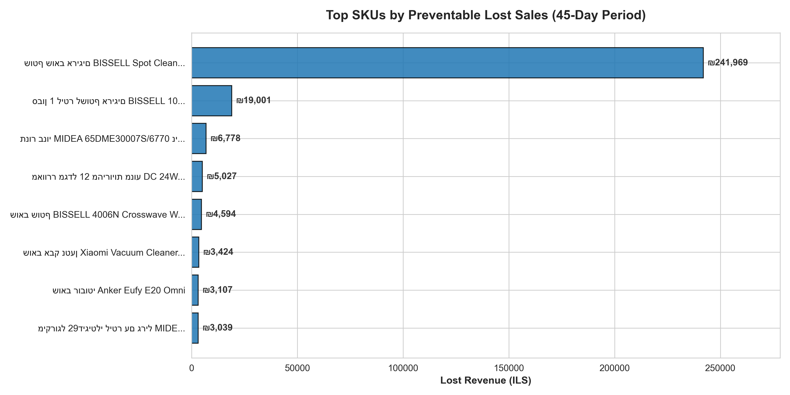

# Retail Inventory Optimization: Donor-Receiver Reallocation Model

An end-to-end data analytics project designed to identify inventory imbalances across retail branches, optimize internal stock reallocation, and quantify preventable lost sales due to stockouts.

---

## Business Problem
In multi-branch retail networks, inventory misallocation often leads to significant revenue loss:
* High-velocity branches frequently experience stockouts (out-of-stock), leading to lost sales and disappointed customers.
* Low-velocity branches hold stagnant, dead stock that ties up working capital and risks depreciation.

Instead of purchasing additional inventory from suppliers, this project implements a Donor-Receiver Optimization Model to reallocate existing stock internally across branches of the same chain.

---

## Methodology & Architecture

### 1. Data Cleaning & Anomaly Handling
* Handled negative stock reports and zero-inventory reporting anomalies to establish accurate, realistic branch sales velocity.
* Analyzed a multi-branch retail dataset spanning 45 consecutive days.

### 2. Velocity & Days of Supply (DOS) Segmentation
* Calculated daily sales run-rate per item and branch.
* Segmented branches using Days of Supply (DOS):
  * Receivers: Fast-moving branches with DOS <= 3 (experiencing stockouts or imminent depletion).
  * Donors: Low-performing branches with stagnant inventory (DOS >= 40 or zero sales with active stock).

### 3. Allocation Engine
Designed a conservative matching logic:
Transfer Units = min(50% of Donor Stock, Receiver's 7-Day Demand)
* Protects donors from complete depletion.
* Prevents over-saturating receiver storage capacity.

### 4. Preventable Lost Sales Quantification
Isolated true preventable loss—revenue lost specifically because items were out of stock in a high-demand branch while sitting idle in another branch of the same chain:
Lost Sales (ILS) = Out-of-Stock Days * Daily Velocity * Unit Price

### 5. Operational Feasibility Threshold
Filtered out operational noise by setting a minimum reallocation threshold (>= ILS 300 per transfer) to ensure logistics and handling costs do not exceed the transfer value.

---

## Key Findings & Business Impact

| Metric | Result |
| :--- | :--- |
| **Identified Preventable Lost Sales (45 Days)** | **ILS 401,018** |
| **Ongoing Daily Revenue Leakage** | **~ILS 21,481 / day** |
| **Primary Inefficiency Concentration** | **Chain C (~80% of total reallocatable value)** |
| **Actionable Inventory Value Unlocked** | **ILS 400,000+** |


* Key bottlenecks were heavily concentrated in specific chains and branches (e.g., Branch C-04 suffering chronic supply shortages across multiple high-demand SKUs).

---

## Tech Stack & Skills
* Language: Python
* Libraries: Pandas, NumPy, Matplotlib / Seaborn
* Core Competencies: Supply Chain Analytics, Inventory Optimization (DOS), Business Feasibility Modeling, Revenue Leakage Estimation.

---

## How to Run
```bash
git clone [https://github.com/your-username/retail-inventory-reallocation.git](https://github.com/your-username/retail-inventory-reallocation.git)
cd retail-inventory-reallocation
jupyter notebook inventory_analysis.ipynb

